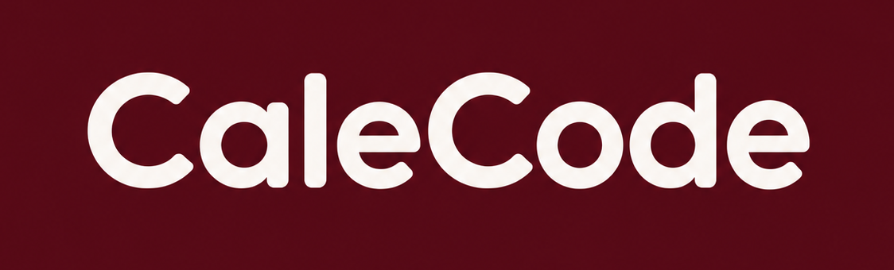
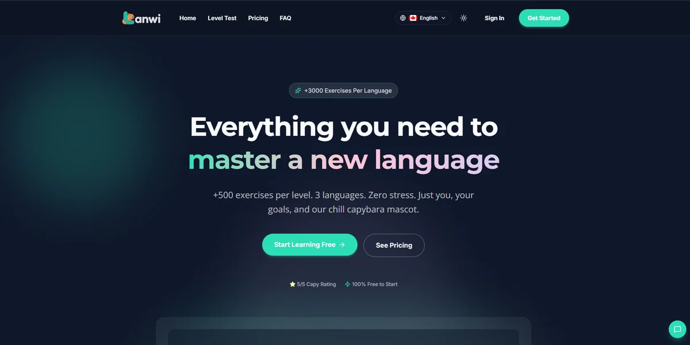
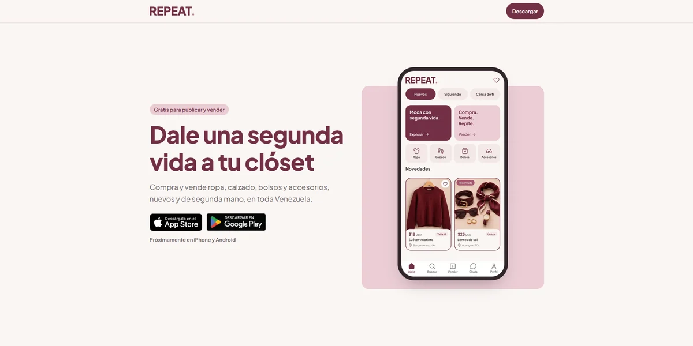
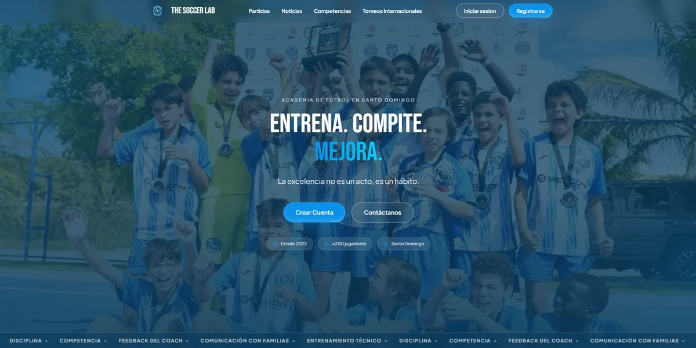
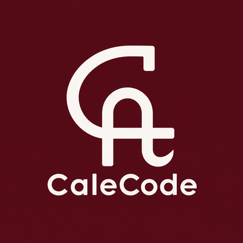

 

<h1>Hey, I'm Carlos! 👋</h1>

<strong>Carlos Cabrera Semidey</strong>

Software Engineer &nbsp;•&nbsp; Full-Stack Developer &nbsp;•&nbsp; Product Builder

Building web apps, mobile experiences, and digital products for real people.

📍 Toronto, Canada &nbsp;|&nbsp; 💻 Building through <a href="https://www.calecode.dev/">CaleCode</a>

  
  
  

## 👨‍💻 About me

I am a software engineer who enjoys taking ideas from concept to working product. Through **[CaleCode](https://www.calecode.dev/)**, I create software for clients and build independent products, combining engineering, product thinking, and user experience.

- 🚀 **What I build:** web platforms, mobile applications, APIs, and SaaS products.
- 🧩 **How I work:** full-stack development, practical architecture, and thoughtful UX.
- 🌱 **What interests me:** AI-powered experiences, scalable systems, and early-stage products.
- 🤝 **Let's collaborate:** [explore my work](https://www.calecode.dev/) or [connect on LinkedIn](https://www.linkedin.com/in/carloscabrerasemidey/).

## 🛠️ Technologies & tools

**Languages & web**

**Mobile, backend & data**

 

**Cloud & workflow**

<b>View my broader toolkit</b>

 

| Area | Technologies |
| :-- | :-- |
| **Languages** | TypeScript, JavaScript, Python, SQL, PHP, Go, Rust, C, C++, C# |
| **Frontend & UI** | React, Next.js, Vue.js, Nuxt.js, Redux, Tailwind CSS, Sass, Bootstrap |
| **Mobile** | React Native, Expo |
| **Backend & APIs** | Node.js, Express, Django, REST APIs, GraphQL |
| **Databases & auth** | PostgreSQL, MySQL, MongoDB, Supabase, Firebase, Appwrite, Clerk, Sequelize |
| **Cloud & infrastructure** | AWS, Docker, Vercel, GitHub Actions, CI/CD |
| **Quality & developer tools** | Git, Jest, Vitest, Playwright, React Testing Library, Zod, pnpm, Turborepo |
| **AI & product** | OpenAI API, LLM integrations, speech APIs, Figma, Jira |

## 🚀 Featured projects

<table>
<tr>
<td width="50%" valign="top">
  
  <h3>🌎 <a href="https://www.lanwi.app/">LANWI</a></h3>
  
An independent language-learning product with interactive exercises and AI-powered practice.

  
<strong>Independent product</strong> &nbsp;·&nbsp; <a href="https://www.lanwi.app/">Explore LANWI</a>

</td>
<td width="50%" valign="top">
  
  <h3>🛍️ <a href="https://repeat-ve.vercel.app/">REPEAT</a></h3>
  
A mobile-first fashion marketplace for buying and selling new and secondhand pieces in Venezuela.

  
<strong>In development</strong> &nbsp;·&nbsp; <a href="https://repeat-ve.vercel.app/">View demo</a>

</td>
</tr>
</table>

<table>
<tr>
<td width="50%" valign="middle">
  
</td>
<td width="50%" valign="middle">
  <h3>⚽ <a href="https://www.thesoccerlab.pro/">The Soccer Lab</a></h3>
  
A soccer academy platform bringing together club information, matches, competitions, and community updates.

  
<strong>Client project</strong>

  
<a href="https://www.thesoccerlab.pro/">Visit website</a>

</td>
</tr>
</table>

## 🍷 CaleCode

<table>
<tr>
<td width="120" align="center" valign="middle">
  
</td>
<td valign="middle">
  <strong>Software engineering, from idea to product.</strong>
  
CaleCode is my personal brand for client software projects and independent products.

  <a href="https://www.calecode.dev/">Explore CaleCode</a>
</td>
</tr>
</table>

<h3>🤝 Let's build something useful</h3>

Have a product idea, a technical challenge, or a collaboration in mind?

